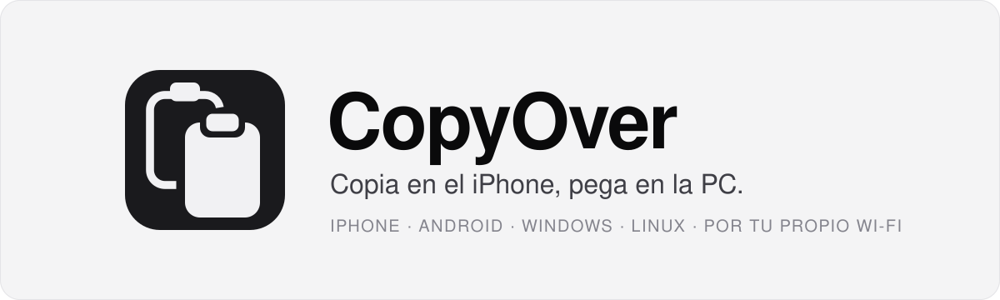
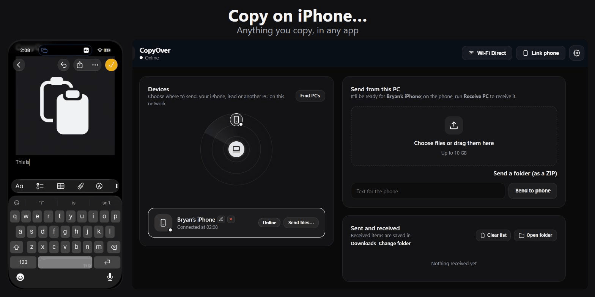
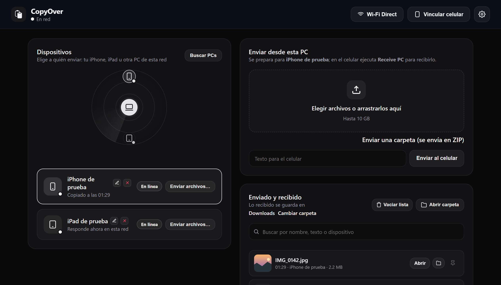

<div align="center">

<a href="#readme">
  <picture>
    <source media="(prefers-color-scheme: dark)" srcset="docs/assets/banner-dark-es.svg">
    <source media="(prefers-color-scheme: light)" srcset="docs/assets/banner-light-es.svg">
    
  </picture>
</a>

**Texto, fotos y archivos entre tu iPhone, Android, Windows y Linux, por tu propio Wi-Fi.**<br>
Sin nube, sin cuenta y sin cable.

[][releases]
[](#1-instálalo-en-tu-pc)
[](#2-vincula-tu-celular)
[](#2-vincula-tu-celular)

[Inicio rápido](#inicio-rápido) · [Documentación](#documentación) · [Hoja de ruta](#hoja-de-ruta) · [Contribuir](CONTRIBUTING.md) · [Seguridad](SECURITY.md)

[English](README.md) · **Español**

[](LICENSE)
[](https://ko-fi.com/copyover)

</div>

<br>

<p align="center"></p>

## Por qué CopyOver

El Portapapeles Universal de Apple solo funciona entre aparatos de Apple. CopyOver lleva la misma idea a Windows y Linux: copias en un aparato y pegas en el otro.
Todo va directo por tu red, protegido con una clave, y lo configuras escaneando un QR.

## Funciones

<p align="center">
  <picture>
    <source media="(prefers-color-scheme: dark)" srcset="docs/screenshots/panel-es.png">
    <source media="(prefers-color-scheme: light)" srcset="docs/screenshots/panel-light-es.png">
    
  </picture>
</p>

**Copiar y pegar entre aparatos**
- Texto y enlaces, con emojis, acentos y varias líneas. Quedan en el portapapeles: pega con <kbd>Ctrl</kbd>+<kbd>V</kbd> donde quieras.
- Fotos, también HEIC del iPhone, con la rotación corregida.
- Lo que copias en la PC (texto, una imagen, un archivo o varios archivos en un `.zip`) queda a un toque en el celular.

**Archivos de cualquier tamaño**
- Hasta 2 GB con el atajo del iPhone, y 10 GB con la página del navegador y entre PCs, escritos al disco mientras llegan.
- Velocidad, porcentaje y tiempo restante en vivo durante las transferencias grandes.
- Los archivos entre PCs se comprueban con SHA-256, y las transferencias se reanudan si se cae la red.

**Encontrar y vincular aparatos**
- Un radar estilo AirDrop muestra los iPhone, iPad y PCs de tu red.
- Vinculas un iPhone o iPad escaneando un QR de un solo uso. Cada uno recibe su propia clave, que puedes revocar desde el panel.
- La app de Android encuentra sola la PC en el Wi-Fi: aceptas en la PC y listo.

**De PC a PC e invitados**
- Clic derecho en cualquier archivo → **Enviar con CopyOver** para mandarlo a otra PC cercana.
- Con un QR de invitado cualquiera sube o baja archivos desde el navegador, sin instalar nada. Los enlaces vencen solos y un botón los corta todos.

**Privado desde el diseño**
- Solo escucha en tu red local. Sin cuenta y sin nube.
- Entre PCs y con la app de Android todo va por TLS, con el certificado propio de cada PC.
- Los atajos del iPhone y las páginas del navegador usan HTTP sin cifrar, así que úsalos en redes de confianza. Mira [Seguridad y límites](docs/security.md) (en inglés).

CopyOver viene en español e inglés, con tema oscuro y claro.

## Plataformas

| | Recibir de la PC | Mandar a la PC | Cómo |
|---|:---:|:---:|---|
| **Windows 10 / 11** | ✓ | ✓ | Instalador, zip portable o Python 3.10+ |
| **Linux** (Fedora, Ubuntu, Debian · GNOME o KDE · Wayland o X11) | ✓ | ✓ | Instalador de una línea o Python 3.10+ |
| **iPhone / iPad** | ✓ | ✓ | Tres atajos, sin instalar ninguna app |
| **Android 8.0+** | ✓ automático con una PC Windows, manual con Linux | ✓ manual, o automático con Shizuku | App nativa (APK) |
| **Cualquier navegador** (invitados, Mac, otros celulares) | ✓ | ✓ | QR de invitado desde el panel |

> [!IMPORTANT]
> Los aparatos tienen que verse en la misma red. Funcionan el Wi-Fi de la casa o la oficina, el hotspot del celular y, en Windows, Wi-Fi Direct; algunas redes de cafés y hoteles no. Mira [Dónde funciona](docs/network.md) (en inglés).

## Inicio rápido

### 1. Instálalo en tu PC

**Windows:** descarga **[CopyOver-Setup.exe][releases]**, ábrelo y toca **Instalar**. Sin permisos de administrador y sin Python. CopyOver se abre junto al reloj y te lleva paso a paso.

> [!NOTE]
> El instalador todavía no está firmado. Si Windows muestra «Windows protegió tu PC», toca **Más información → Ejecutar de todas formas**.

**Linux** (Fedora, Ubuntu o Debian):

```bash
curl -fsSL https://raw.githubusercontent.com/aritabryan/copyover/main/install.sh | bash
```

Instala lo que falte, registra el servicio de usuario `copyover` y lo arranca al iniciar sesión. Más detalles en la [guía de Linux](docs/linux.md) (en inglés).

### 2. Vincula tu celular

**iPhone o iPad:** instala los tres atajos. Luego abre el panel en la PC → **Vincular celular**, escanea el QR con la cámara y toca **Guardar en Atajos**. No escribes ninguna clave.

| [**Link PC**](https://www.icloud.com/shortcuts/e234def0f4144db8b47a1f8db2ce1cdf) | [**Send PC**](https://www.icloud.com/shortcuts/8773928b15af4455a1caa964e0ffe018) | [**Receive PC**](https://www.icloud.com/shortcuts/4f9e695b686b4a0aae42bcf2d2caebb5) |
|---|---|---|
| Guarda la clave y la dirección de la PC desde el QR | Manda lo que copiaste o compartiste | Trae lo que copiaste en la PC |

**Android:** abre el panel en la PC → **Vincular celular → Android** y escanea el QR con la cámara del celular: el APK se descarga desde tu PC. Abre la app, elige tu PC y acepta en el escritorio. Mira la [guía de Android](docs/android.md) (en inglés).

### 3. Pruébalo

Copia algo en el celular, ejecuta **Send PC** (o toca **Enviar** en la notificación de Android) y pega con <kbd>Ctrl</kbd>+<kbd>V</kbd> en la PC.

## Documentación

Las guías están en inglés.

| Quiero… | Lee |
|---|---|
| Instalar, actualizar o desinstalar en Windows, y usar el ícono de la bandeja | [Windows](docs/windows.md) |
| Instalar en Fedora, Ubuntu o Debian, o configurar el arranque dual | [Linux](docs/linux.md) |
| Configurar los atajos del iPhone, ejecutarlos más rápido o armarlos a mano | [Atajos de iPhone y iPad](docs/iphone-shortcuts.md) |
| Usar la app de Android, sus modos de envío y sus actualizaciones | [Android](docs/android.md) |
| Saber qué hace cada parte del panel y compartir con invitados | [El panel](docs/panel.md) |
| Mandar archivos entre dos PCs | [De PC a PC](docs/pc-to-pc.md) |
| Cambiar el puerto, el nombre, el idioma o la carpeta de descargas | [Ajustes (`config.json`)](docs/configuration.md) |
| Saber en qué redes funciona y por qué | [Dónde funciona](docs/network.md) |
| Arreglar un atajo que falla o una PC que no aparece | [Problemas comunes](docs/troubleshooting.md) |
| Entender qué está protegido y qué no | [Seguridad y límites](docs/security.md) · [SECURITY.md](SECURITY.md) |
| Ver cómo está hecho y ubicarme en el código | [Arquitectura](docs/architecture.md) · [CONTRIBUTING.md](CONTRIBUTING.md) |

## Hoja de ruta

| | Estado |
|---|---|
| Invitados limitados a lo que les mandas, y *Cortar acceso de invitados* | Próxima versión |
| *Cambiar la clave común* y tema claro | Próxima versión |
| Instalador de Windows firmado | Todavía no |
| Firma de publicación de Android y ficha en una tienda | Todavía no |

Lo que cambió en cada versión está en el [CHANGELOG](CHANGELOG.md) (en inglés).

## Comunidad

- **Preguntas e ideas:** abre una [discusión](https://github.com/aritabryan/copyover/discussions).
- **Errores:** abre un [issue](https://github.com/aritabryan/copyover/issues) con tu sistema, la versión y los pasos para reproducirlo.
- **Código y traducciones:** los pull requests son bienvenidos en español o inglés. Empieza por [CONTRIBUTING.md](CONTRIBUTING.md).
- **Problemas de seguridad:** repórtalos en privado, como explica [SECURITY.md](SECURITY.md).
- **Cualquier otra cosa:** escribe a [copyover28@gmail.com](mailto:copyover28@gmail.com).

## Apoyo

CopyOver es gratis y lo mantiene una sola persona. Si te ahorra tiempo, puedes [invitarme un café en Ko-fi](https://ko-fi.com/copyover). Una estrella en el repositorio o recomendarlo a alguien también ayuda.

## Licencia

[MIT](LICENSE). Las librerías que usa CopyOver conservan sus propias licencias, y cada compilación las lista: `THIRD-PARTY-NOTICES.txt` junto a `CopyOver.exe` en Windows, y *Ajustes → Licencias de código abierto* en la app de Android. Más detalles en [Arquitectura](docs/architecture.md#licenses).

[releases]: https://github.com/aritabryan/copyover/releases/latest
