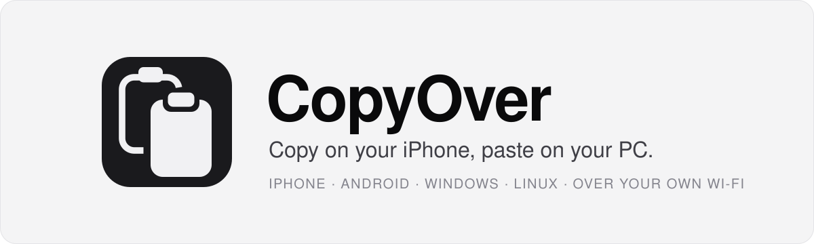
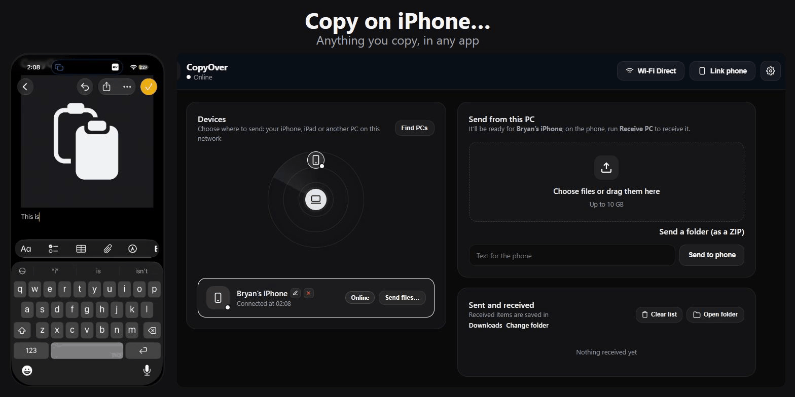
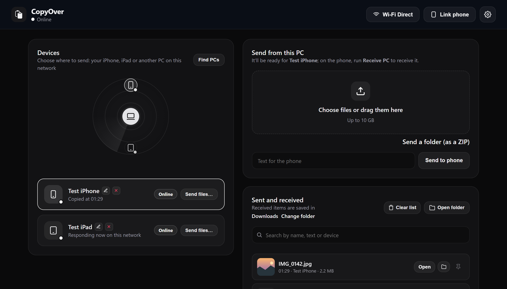

<div align="center">

<a href="#readme">
  <picture>
    <source media="(prefers-color-scheme: dark)" srcset="docs/assets/banner-dark.svg">
    <source media="(prefers-color-scheme: light)" srcset="docs/assets/banner-light.svg">
    
  </picture>
</a>

**Text, photos and files between your iPhone, Android, Windows and Linux, over your own Wi-Fi.**<br>
No cloud, no account, no cable.

[][releases]
[](#1-install-it-on-your-pc)
[](#2-link-your-phone)
[](#2-link-your-phone)

[Quick start](#quick-start) · [Documentation](#documentation) · [Roadmap](#roadmap) · [Contributing](CONTRIBUTING.md) · [Security](SECURITY.md)

**English** · [Español](README.es.md)

[](LICENSE)
[](https://ko-fi.com/copyover)

</div>

<br>

<p align="center"></p>

## Why CopyOver

Apple’s Universal Clipboard only works between Apple devices. CopyOver brings the same idea to Windows and Linux: copy on one device, paste on the other.
Everything goes straight over your network, protected by a key, and you set it up by scanning a QR code.

## Features

<p align="center">
  <picture>
    <source media="(prefers-color-scheme: dark)" srcset="docs/screenshots/panel.png">
    <source media="(prefers-color-scheme: light)" srcset="docs/screenshots/panel-light.png">
    
  </picture>
</p>

**Copy and paste across devices**
- Text and links, with emoji, accents and several lines. They land on the clipboard: press <kbd>Ctrl</kbd>+<kbd>V</kbd> anywhere.
- Photos, including iPhone HEIC, with the rotation fixed.
- What you copy on the PC (text, an image, a file, or several files as a `.zip`) is one tap away on the phone.

**Files of any size**
- Up to 2 GB with the iPhone shortcut, and 10 GB with the browser page and between PCs, written to disk as they arrive.
- Live speed, percent done and time left during large transfers.
- Files between PCs are checked with SHA-256, and transfers resume after a network drop.

**Find and link devices**
- An AirDrop-style radar shows the iPhones, iPads and PCs on your network.
- Link an iPhone or iPad by scanning a one-time QR code. Each one gets its own key, which you can revoke from the panel.
- The Android app finds the PC on the Wi-Fi by itself: accept on the PC and you’re done.

**PC to PC and guests**
- Right-click any file → **Send with CopyOver** to send it to another PC nearby.
- A guest QR code lets anyone upload or download files from their browser, with nothing to install. Links expire on their own, and one button cuts them all off.

**Private by design**
- It only listens on your local network. No account and no cloud.
- Traffic between PCs and with the Android app goes over TLS, with each PC’s own certificate.
- The iPhone shortcuts and browser pages use plain HTTP, so use them on networks you trust. See [Security and limits](docs/security.md).

CopyOver comes in English and Spanish, with dark and light themes.

## Platforms

| | Receive from the PC | Send to the PC | How |
|---|:---:|:---:|---|
| **Windows 10 / 11** | ✓ | ✓ | Installer, portable zip or Python 3.10+ |
| **Linux** (Fedora, Ubuntu, Debian · GNOME or KDE · Wayland or X11) | ✓ | ✓ | One-line installer or Python 3.10+ |
| **iPhone / iPad** | ✓ | ✓ | Three shortcuts, no app to install |
| **Android 8.0+** | ✓ automatic with a Windows PC, manual with Linux | ✓ manual, or automatic with Shizuku | Native app (APK) |
| **Any browser** (guests, Mac, other phones) | ✓ | ✓ | Guest QR code from the panel |

> [!IMPORTANT]
> The devices have to see each other on the same network. Home and office Wi-Fi, your phone’s hotspot and, on Windows, Wi-Fi Direct work; some café and hotel networks don’t. See [Where it works](docs/network.md).

## Quick start

### 1. Install it on your PC

**Windows:** download **[CopyOver-Setup.exe][releases]**, open it and click **Install**. No admin rights and no Python. CopyOver opens next to the clock and walks you through the rest.

> [!NOTE]
> The installer isn’t signed yet. If Windows shows «Windows protected your PC», click **More info → Run anyway**.

**Linux** (Fedora, Ubuntu or Debian):

```bash
curl -fsSL https://raw.githubusercontent.com/aritabryan/copyover/main/install.sh | bash
```

It installs what’s missing, registers the `copyover` user service and starts it on login. More in the [Linux guide](docs/linux.md).

### 2. Link your phone

**iPhone or iPad:** install the three shortcuts. Then open the panel on the PC → **Link phone**, scan the QR code with the camera and tap **Save to Shortcuts**. No key to type.

| [**Link PC**](https://www.icloud.com/shortcuts/e234def0f4144db8b47a1f8db2ce1cdf) | [**Send PC**](https://www.icloud.com/shortcuts/8773928b15af4455a1caa964e0ffe018) | [**Receive PC**](https://www.icloud.com/shortcuts/4f9e695b686b4a0aae42bcf2d2caebb5) |
|---|---|---|
| Saves the PC’s key and address from the QR code | Sends what you copied or shared | Brings what you copied on the PC |

**Android:** open the panel on the PC → **Link phone → Android** and scan the QR code with the phone’s camera: the APK downloads straight from your PC. Open the app, pick your PC and accept on the desktop. See the [Android guide](docs/android.md).

### 3. Try it

Copy something on the phone, run **Send PC** (or tap **Send** in the Android notification) and press <kbd>Ctrl</kbd>+<kbd>V</kbd> on the PC.

## Documentation

| I want to… | Read |
|---|---|
| Install, update or uninstall on Windows, and use the tray icon | [Windows](docs/windows.md) |
| Install on Fedora, Ubuntu or Debian, or set up dual boot | [Linux](docs/linux.md) |
| Set up the iPhone shortcuts, run them faster, or build them by hand | [iPhone and iPad shortcuts](docs/iphone-shortcuts.md) |
| Use the Android app, its sending modes and its updates | [Android](docs/android.md) |
| Learn what each part of the panel does, and share with guests | [The panel](docs/panel.md) |
| Send files between two PCs | [PC to PC](docs/pc-to-pc.md) |
| Change the port, name, language or download folder | [Settings (`config.json`)](docs/configuration.md) |
| Know which networks work, and why | [Where it works](docs/network.md) |
| Fix a shortcut that fails or a PC that isn’t found | [Troubleshooting](docs/troubleshooting.md) |
| Understand what is protected and what isn’t | [Security and limits](docs/security.md) · [SECURITY.md](SECURITY.md) |
| See how it’s built and find my way around the code | [Architecture](docs/architecture.md) · [CONTRIBUTING.md](CONTRIBUTING.md) |

## Roadmap

| | Status |
|---|---|
| Guests limited to what you send them, and *Cut off guest access* | Next release |
| *Change the shared key*, and a light theme | Next release |
| Signed Windows installer | Not yet |
| Android release signing and a store listing | Not yet |

What changed in each version is in the [CHANGELOG](CHANGELOG.md).

## Community

- **Questions and ideas:** start a [discussion](https://github.com/aritabryan/copyover/discussions).
- **Bugs:** open an [issue](https://github.com/aritabryan/copyover/issues) with your system, the version and the steps to reproduce it.
- **Code and translations:** pull requests are welcome in English or Spanish. Start with [CONTRIBUTING.md](CONTRIBUTING.md).
- **Security problems:** report them privately, as [SECURITY.md](SECURITY.md) explains.
- **Anything else:** write to [copyover28@gmail.com](mailto:copyover28@gmail.com).

## Support

CopyOver is free and maintained by one person. If it saves you time, you can [buy me a coffee on Ko-fi](https://ko-fi.com/copyover). A star on the repository or telling a friend helps too.

## License

[MIT](LICENSE). The libraries CopyOver uses keep their own licenses, and each build lists them: `THIRD-PARTY-NOTICES.txt` next to `CopyOver.exe` on Windows, and *Settings → Open source licenses* in the Android app. Details in [Architecture](docs/architecture.md#licenses).

[releases]: https://github.com/aritabryan/copyover/releases/latest
