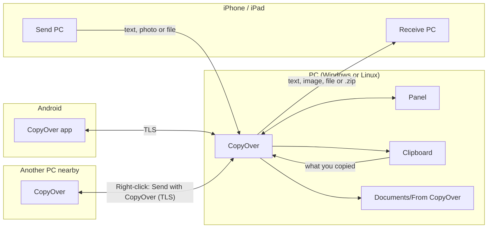

# Architecture

[← Back to the README](../README.md)

How CopyOver is built, for contributors. How to run the tests and where each language’s texts live is in [CONTRIBUTING.md](../CONTRIBUTING.md).

## How it fits together

## Design

- **HTTP server without frameworks:** `http.server` with `ThreadingHTTPServer`. The shortcuts’ `multipart/form-data` is split as it arrives, so large files go straight to disk, and PC-to-PC sends (`/p2p/*`) write 1 MB chunks straight to disk, checking SHA-256. HTTP and TLS share port 8765: the server looks at the first byte of each connection.
- **Panel:** a single-page app with no heavy libraries (HTML5, CSS and vanilla JS) in `web/`, served at `/app` and shown in its own `pywebview` window, with the browser as a fallback.
- **Windows:** clipboard through the Win32 API via `ctypes` (`CF_UNICODETEXT`, `CF_HDROP`), images and file lists with .NET from PowerShell, and shortcuts in the Start menu, Startup and `SendTo`.
- **Linux:** `wl-clipboard` (Wayland) or `xclip` (X11), with the Nautilus (`x-special/gnome-copied-files`) and Dolphin (`text/uri-list`) formats, plus right-click scripts.
- **One module per OS** with the same interface; the right one is picked at startup.
- **mDNS with `zeroconf`:** the PC announces itself as `<name>.local` (`_http._tcp`) for the iPhone, and as `_puente._tcp.local.` to find other nearby PCs.
- **`tkinter` dialogs** run in a separate process so they don’t clash with the `pystray` loop.
- **HEIC photos** are converted with `pillow-heif`, applying the EXIF orientation and keeping the color profile, the date and the location. One that can’t be decoded is saved as it arrived.
- **Key** generated with `secrets` and compared in constant time (`hmac.compare_digest`).
- **English and Spanish:** English is the source text and the default; `t()` and the Spanish table provide Spanish, and the pages are translated as they’re served.
- **Tray icon** with `pystray`; autostart through the Startup folder (Windows) or the `copyover` systemd user service (Linux).
- **Android:** a native app in Kotlin/Compose with a Rust/JNI HTTP engine. See [android/README.md](../android/README.md).

Some protocol names (the `_puente._tcp` mDNS service, the `/ping` reply) come from the project’s first name, *Puente* (“bridge”), and stay as they are so existing installs keep working.

## Where things are

| Area | Files | Purpose |
|---|---|---|
| Entry point | `copyover.py` | Starts CopyOver (`python copyover.py`) and its command-line options |
| Server | `bridge.py`, `puente.py` (old entry point, still works) | HTTP server, iPhone/Android routes and `/p2p/*`, mDNS announcement |
| Panel routes | `panel_routes.py`, `local_secret.py` | The panel’s `/app/*` routes (only from this PC) and the per-run local secret |
| Uploads | `receiving.py` | Splits what reaches `/send` and the guest page as it arrives, without holding it in RAM |
| Settings | `configuration.py` | Reads and saves `config.json` under a lock |
| Pages | `web/`, `web_ui.py` | The pages as plain HTML, CSS and JS (panel, quick view, guest page, QR pages) and the code that fills them in |
| Languages | `i18n.py`, `strings_es.py` | `t()` for Python and page translation; English is the source, Spanish comes from the dictionary |
| Diagnostics | `diagnostics.py` | Firewall, network and port checks shown in the panel |
| PC to PC | `p2p.py`, `p2p_send.py`, `p2p_receive.py`, `dialogs.py` | Discovery, offers, chunked transfers, SHA-256 and pairing; `tkinter` windows to pick a computer, accept transfers and confirm codes |
| Windows | `windows_system.py`, `helper.ps1` | Clipboard, notifications, Start menu, right-click and autostart; images, files and notifications through .NET/WinRT |
| Linux | `linux_system.py`, `install.sh` | Clipboard, notifications, right-click and autostart; the one-line installer |
| Tray and windows | `tray.py`, `tray_actions.py`, `preview.py`, `panel_window.py` | Status icon and menu, quick view and panel window with `pywebview` |
| Linking | `linking.py`, `pairing.py`, `pc_pairing.py` | Discovery identity and settings for Android; pairing requests, local acceptance and encrypted delivery |
| Updates | `updates.py` | New-version notice, one-click update, and the verified APK cache for Android |
| Packaging | `bundle.py`, `copyover.spec`, `build.ps1`, `installer.iss` | `CopyOver.exe` with PyInstaller and the Inno Setup installer |
| Tools | `tools/` | Build helpers, such as the third-party notices generator |
| Android | `android/` | Native Android app |
| Tests | `tests/` | Tests for the protocol shared by Android and the shortcuts, and more |

## Licenses

CopyOver is under the [MIT license](../LICENSE). The libraries it uses keep their own licenses, and each build lists them, generated from what actually goes inside:

- **Windows:** `THIRD-PARTY-NOTICES.txt`, next to `CopyOver.exe` (generated by `tools/third_party_notices.py`). pystray and zeroconf (LGPL) go as loose files inside `_internal`, so they can be replaced.
- **Android:** *Settings → Open source licenses* in the app ([AboutLibraries](https://github.com/mikepenz/AboutLibraries) for the Java and Kotlin libraries, [cargo-about](https://github.com/EmbarkStudios/cargo-about) for the Rust ones). The build fails if a library with a license that isn’t allowed comes in.
