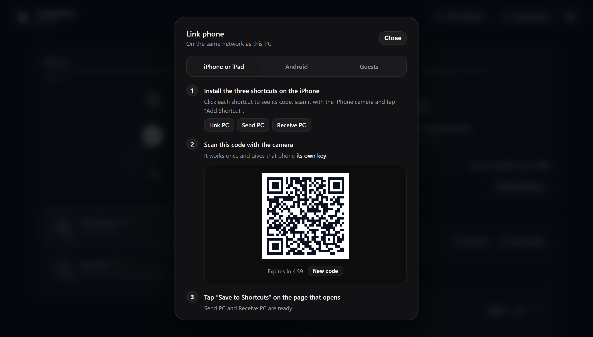

# iPhone and iPad shortcuts

[← Back to the README](../README.md)

iOS won’t let an app send the clipboard on its own, so CopyOver uses three Shortcuts. There is no app to install.

- [Set up](#set-up)
- [What happens when you send and receive](#what-happens-when-you-send-and-receive)
- [Ways to run the shortcuts](#ways-to-run-the-shortcuts)
- [Large files](#large-files)
- [How the shortcuts find the PC](#how-the-shortcuts-find-the-pc)
- [Build them by hand](#build-them-by-hand)
- [How the links are made (for maintainers)](#how-the-links-are-made-for-maintainers)

## Set up

| Shortcut | What it does | |
|---|---|---|
| **Link PC** | Saves the PC’s key and address when you scan the panel’s QR code | [**Install**](https://www.icloud.com/shortcuts/e234def0f4144db8b47a1f8db2ce1cdf) |
| **Send PC** | Sends what you copied, or whatever you share from any app | [**Install**](https://www.icloud.com/shortcuts/8773928b15af4455a1caa964e0ffe018) |
| **Receive PC** | Brings to the iPhone what you copied on the PC | [**Install**](https://www.icloud.com/shortcuts/4f9e695b686b4a0aae42bcf2d2caebb5) |

1. Install the three shortcuts.
2. On the PC, open the **CopyOver panel** → **Link phone**.
3. Scan the QR code with the camera and tap **Save to Shortcuts**. No key to type.
4. The first time, iOS asks whether Shortcuts may use the **local network**: tap **Allow**.

Try it: copy something on the iPhone, run **Send PC** and press <kbd>Ctrl</kbd>+<kbd>V</kbd> on the PC.

<p align="center"></p>

> [!TIP]
> The QR code works once. When scanned, that iPhone or iPad gets **its own key** (not the PC’s shared key), and the PC recognizes it by that key even if it changes network or name. If you remove it from the panel, its key stops working. If the shared key may have leaked, *Settings → Change the shared key* replaces it; only shortcuts set up by hand and devices linked with an earlier version need linking again.

Scanning the QR code isn’t enough for the device to show up in the panel: it appears once its key reaches the PC (Link PC, Send PC or Receive PC). Keys scanned but never used are removed after an hour.

## What happens when you send and receive

| From the iPhone you send… | On the PC… |
|---|---|
| Text or a link | It’s copied: <kbd>Ctrl</kbd>+<kbd>V</kbd> anywhere |
| A photo | It’s copied as an image and saved in `Documents/From CopyOver` |
| Files or several photos | They’re saved in `Documents/From CopyOver`, ready to paste into a folder or an email |

| On the PC you copy… | The iPhone gets… |
|---|---|
| Text or an image | It on the clipboard |
| A file (<kbd>Ctrl</kbd>+<kbd>C</kbd> in File Explorer) | The file, to paste into Files, WhatsApp or Mail |
| Several files or a folder | A `.zip` with everything |

> Folders from older versions (`From iPhone`, `Desde iPhone` and the like) stay where they are, and the history keeps pointing to them, so nothing is lost.

**Receive PC** first asks the PC what it has (`/receive/type`: `text`, `image`, `file` or `none`) and always copies it to the clipboard. A single photo or video stays there; any other file also opens the share sheet, where you can save it to Files or send it straight to an app such as WhatsApp. What counts as a photo or video for the clipboard only is set by `phone_clipboard` in [`config.json`](configuration.md).

## Ways to run the shortcuts

iOS won’t send the clipboard on its own, so you need a gesture:

| Way | Where to set it up | Available on | Guide |
|---|---|---|---|
| **Control Center** (recommended) | Control Center → **+** → **Add a Control** → **Shortcut** | iPhone and iPad (iOS 18+) | [Apple](https://support.apple.com/guide/shortcuts/run-shortcuts-from-control-center-apd06a9201d4/ios) |
| **Back Tap** | Settings → Accessibility → Touch → **Back Tap** | iPhone 8 or later | [Apple](https://support.apple.com/guide/shortcuts/run-shortcuts-tapping-iphone-apd897693606/ios) |
| **Action Button** | Settings → **Action Button** → **Shortcut** | iPhone 15 Pro and later | [Apple](https://support.apple.com/guide/shortcuts/run-shortcuts-with-the-action-button-apdfea15680b/ios) |
| **Share menu** (recommended) | Already in **Send PC** | iPhone and iPad | — |
| **Widget** | Home Screen → **Edit** → **Add Widget** → **Shortcuts** | iPhone and iPad | [Apple](https://support.apple.com/guide/shortcuts/run-shortcuts-from-the-home-screen-widget-apd029b36d05/ios) |
| **Icon** | In Shortcuts: shortcut → **Share** → **Add to Home Screen** | iPhone and iPad | [Apple](https://support.apple.com/guide/shortcuts/add-a-shortcut-to-the-home-screen-apd735880972/ios) |
| **Siri** | Nothing: say “Hey Siri, Send PC” | iPhone and iPad | [Apple](https://support.apple.com/guide/shortcuts/run-shortcuts-with-siri-apd07c25bb38/ios) |
| **Lock Screen** | Long-press → **Customize** → bottom button → **Shortcut** | iPhone (iOS 18+) | — |

**Recommended:** Control Center day to day, and the share menu for photos and files.

## Large files

| Direction | How | Up to |
|---|---|---|
| iPhone → PC | **Send PC** from the share sheet | **2 GB** (tested on an iPhone 17) |
| iPhone → PC | Browser page (*Link phone → Guests*) | 10 GB |
| PC → iPhone | **Receive PC** | 500 MB |
| PC → iPhone | Browser page, *Get it on this device* button | 10 GB |

- **The PC never holds the whole file in memory.** What reaches `/send` or the guest page is written to the downloads folder as it arrives; a 2 GB send uses less than 100 MB of RAM on the PC. It checks for free disk space first, and deletes whatever arrived if the send is cut off.
- **Why 2 GB for the shortcut.** From the share sheet, iOS runs the shortcut with little memory and Apple doesn’t publish the limit. Up to 2 GB arrived intact (same SHA-256); larger files may make the shortcut close without a message. The browser page is there for those.
- **Why 500 MB for Receive PC.** That shortcut puts what it gets on the iPhone’s clipboard, which lives in memory. If what’s ready is bigger, the shortcut gets a text explaining how to download it and the panel shows a notice; Android and other clients get a size error instead, so they don’t copy that explanation as content.
- **Safari downloads.** By default Safari saves to *iCloud Drive → Downloads* and uploads it to iCloud. For large files, switch it to *On My iPhone* in Settings → Apps → Safari → Downloads.

## How the shortcuts find the PC

The shortcuts carry no key or address: **Send PC** and **Receive PC** read `iCloud Drive/Shortcuts/copyover/<Device Name>.txt`, which **Link PC** writes when you tap **Save to Shortcuts** on the QR page. The file looks like this:

```json
{"key":"this device's key","server":"http://copyover-pc.local:8765","fallback":"http://192.168.1.5:8765"}
```

The file name comes from the Shortcuts **Device Name** variable, so an iPhone and an iPad on the same iCloud account each have their own file and key, even though the shortcuts sync between them: scan a QR code on each device and the panel shows two devices. If two devices had exactly the same name they would share the file (and the key); just rename one in Settings → General → About.

To switch PCs, or if you removed the device from the panel, scan a new QR code. If you’d rather not install the third shortcut, copy the key from the QR page and paste it by hand into the `X-Key` header of the other two.

> If `.local` doesn’t resolve on your network, use `fallback` instead of `server` in both shortcuts (it’s the PC’s direct IP).

## Build them by hand

<details>
<summary><b>Link PC</b></summary>

The name must be exactly **Link PC**: the QR page opens it with `shortcuts://run-shortcut?name=Link PC`. If you installed it when it was called *Vincular con PC*, rename it to **Link PC**.

```
Receive Text input from Share Sheet
  If there's no input: Ask For Input
Get Device Details  Device Name
Save File  [Shortcut Input]
   Service: Shortcuts
   Ask Where to Save: off
   Destination Path: copyover/[Device Name].txt
   Overwrite If File Exists: on
Get File  Shortcuts / copyover/[Device Name].txt
Get Dictionary from Input          -> Config
Get Dictionary Value  key    in Config  -> Key
Get Dictionary Value  server in Config  -> Server
URL Encode  [Device Name]          -> EncodedName
Get Contents of URL  [Server]/ping?device=[EncodedName]
   Method: GET
   Headers: X-Key -> [Key]
Show Notification  "Done: this device is linked with the PC"
```

In *Destination Path* and *Get File* type `copyover/`, insert the **Device Name** variable and finish with `.txt`.

The end checks the link: it reads the key **from the file it just saved**, like Send PC and Receive PC, and uses it to tell the PC. If the file wasn’t saved right, the shortcut fails right there and not the first time you send something. The name goes in the URL (`?device=`) and not in a header because iOS cuts headers at the first non-ASCII character: «Ana’s iPhone» would arrive as «Ana».

> [!WARNING]
> Two Shortcuts traps. The service must be **Shortcuts** (the `iCloud Drive/Shortcuts` folder) in all three shortcuts, because with **iCloud Drive** the file lands in the root and *Get File* can’t find it. And the extension must be **`.txt`**, because Shortcuts saves text as `.txt` even if the path says `.json` (Files hides it, so the name seems to match). The content is still JSON and *Get Dictionary from Input* reads it fine.

</details>

<details>
<summary><b>Send PC</b></summary>

1. Shortcut details → turn on **Show in Share Sheet**.
2. **Receive … from Share Sheet** block: type **Any**, and under **If there’s no input** → **Continue**.
3. **Get Device Details** → **Device Name**.
4. **Get File** → Service **Shortcuts**, File Path `copyover/[Device Name].txt`, **Show Document Picker** off.
5. **Get Dictionary from Input** and two **Get Dictionary Value** (`key` and `server`); rename the variables so you don’t mix them up.
6. **If** Shortcut Input **has any value** → **Get Shortcut Input**; **Otherwise** → **Get Clipboard**. That way the same shortcut takes what you share and what you copied.
7. **Repeat with each item in** If Result, and inside it:
   - **Get Type** of Repeat Item.
   - **If Any are true**: Type **is** Photo media, Type **is** Image → **Convert** Repeat Item to JPEG with **Preserve Metadata** on, so the photo keeps its date and location. **Otherwise** → **Get Variable** Repeat Item.
   - **If** Repeat Item **begins with** `http` (set its type to **Text** if the option doesn’t appear) → **Get Contents of URL** with a **Text** field `file` → **If Result**. With a File field, Shortcuts would download the page and send it as HTML.
   - **Otherwise** → **Get Contents of URL** with a **File** field `file` → **If Result**.
   - Don’t tell links apart with **Get URLs from Input** or **Get Images from Input**: photos can have a URL, so only their name would arrive, and links can have images, so the page would arrive.
   - Both **Get Contents of URL**: URL `[server]/send` (type `/send` right after the variable), **Method** POST, **Headers** `X-Key` → `[key]` and `X-Device` → `[Device Name]`.

```
Receive Any input from Share Sheet
  If there's no input: Continue
Get Device Details  Device Name
Get File  Shortcuts / copyover/[Device Name].txt
Get Dictionary from Input          -> Config
Get Dictionary Value  key    in Config  -> Key
Get Dictionary Value  server in Config  -> Server
If  Shortcut Input has any value
   Get  Shortcut Input
Otherwise
   Get Clipboard
End If
Repeat with each item in  If Result
   Get Type  Repeat Item
   If  Any are true: Type is Photo media, Type is Image
      Convert  Repeat Item to JPEG   Preserve Metadata: on
   Otherwise
      Get Variable  Repeat Item
   End If
   If  Repeat Item begins with http
      Get Contents of URL  [Server]/send   POST, X-Key -> [Key], X-Device -> [Device Name]
         Request Body: Form   file (Text) -> [If Result]
   Otherwise
      Get Contents of URL  [Server]/send   POST, X-Key -> [Key], X-Device -> [Device Name]
         Request Body: Form   file (File) -> [If Result]
   End If
End Repeat
```

</details>

<details>
<summary><b>Receive PC</b></summary>

```
Get Device Details  Device Name
Get File  Shortcuts / copyover/[Device Name].txt
Get Dictionary from Input          -> Config
Get Dictionary Value  key    in Config  -> Key
Get Dictionary Value  server in Config  -> Server
Get Contents of URL  [Server]/receive/type   -> Type
   Method: GET
   Headers: X-Key -> [Key]
            X-Device -> [Device Name]
Get Contents of URL  [Server]/receive        -> Content
   Method: GET
   Headers: X-Key -> [Key]
            X-Device -> [Device Name]
Copy to Clipboard  [Content]
If [Type] is "file"
   Share  [Content]
End If
```

The PC decides what to send; the shortcut has no logic of its own. Text also stays on the clipboard, and if what’s ready is over 500 MB the shortcut gets a text that explains why.

</details>

## How the links are made (for maintainers)

1. In Shortcuts, long-press the shortcut → **Duplicate**, and give it a different name from the original.
2. Check that no key or PC name is left in any field (reading them from the file, there shouldn’t be).
3. Share menu → **Copy iCloud Link**.
