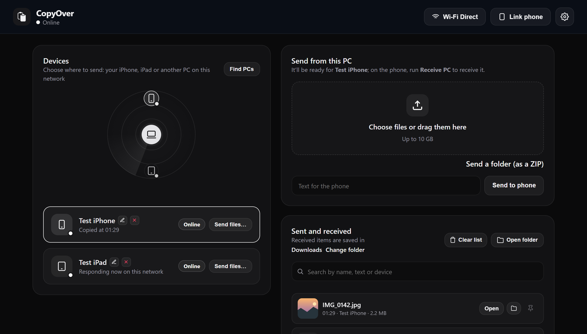
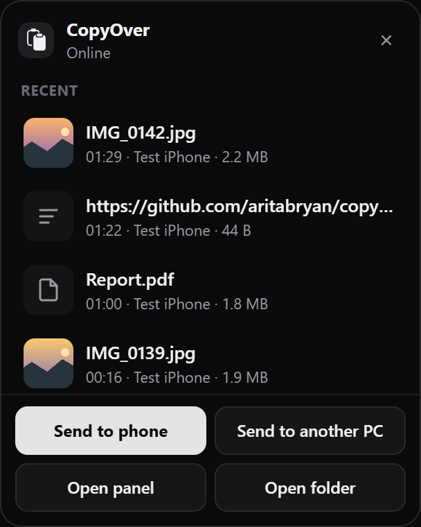
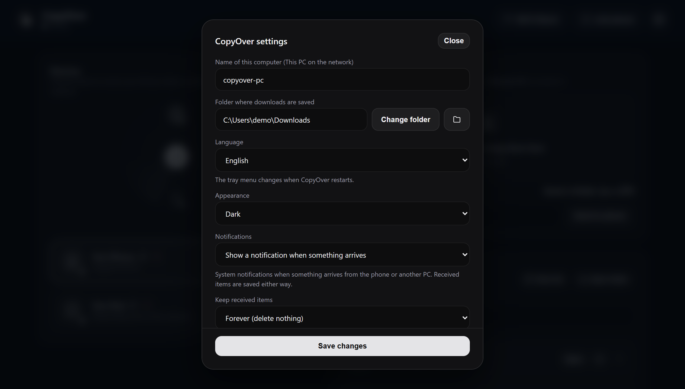

# The panel

[← Back to the README](../README.md)

The panel is a two-column page in its own window: devices on the left, sending and received items on the right. It comes in dark (the default), light, or the same as the system (*Settings → Appearance*).

  <picture>
    <source media="(prefers-color-scheme: dark)" srcset="screenshots/panel.png">
    <source media="(prefers-color-scheme: light)" srcset="screenshots/panel-light.png">
    
  </picture>

## How to open it

- **Left- or right-click the tray icon** to open the [quick view](#quick-view) next to the clock (Windows only; Linux keeps the native menu).
- **Open panel** in the quick view (or in the Linux menu) opens the full panel.
- Search for **CopyOver** in Start to launch it without a console, or use autostart.
- Typing `http://127.0.0.1:8765/app` in a browser doesn’t open it: the panel only answers the windows that CopyOver opens itself (see [SECURITY.md](../SECURITY.md)).

## Quick view

Like OneDrive’s, it opens next to the clock, the same with the left or the right mouse button or the keyboard. The history is visible on opening: a scrolling list of copies with thumbnails (click or <kbd>Enter</kbd> copies, “Open” opens files and links). The buttons stay fixed below it:

- **Send to phone** and **Send to another PC**.
- **Linked computers:** the linked phones and PCs, connected or not, plus **Manage linked PCs…**, **Link Android**, **Link iPhone or iPad** and **Link another PC**.
- **Settings:** **Start with Windows**, **File notifications** and **Language**.
- **Open panel**, **Open folder** (the downloads folder) and **Quit**.

It takes focus when it opens and hides when you click outside or press <kbd>Esc</kbd>. It uses `pywebview` (WebView2, built into Windows) and exists only on Windows.

## What’s in it

1. **Live radar:** every device found on the local network (iPhone, iPad, Windows or Linux laptops), with names resolved over mDNS and IP.
2. **Drag and drop zone:** drop files or folders from File Explorer to send them, or to get them ready for the phone to pick up.
3. **Quick text:** a box to type notes, long links or messages and send them straight to the clipboard or to the phone.
4. **Live speed:** MB/s, percent done and time left during large transfers.
5. **Guest sharing:** see [Guests](#guests).
6. **Custom folder:** choose where downloads are saved, or reset it with one click.
7. **Always accept from a known PC:** when another PC sends you files, tick *Automatically accept from this computer next time* in the confirmation window, and later transfers from that PC are saved without asking.
8. **Transfer history:** recent sends and receives with size, exact time and buttons to open the file or show it in File Explorer.
9. **Link a phone with a QR code:** a one-time QR code that opens the setup page in Safari on the phone. The **Link phone** window has three tabs: iPhone or iPad, Android, and Guests.

Settings screen

## Guests

The **Guests** tab (*Link phone → Guests*) shows a QR code so anyone on the network (Android, Mac, Linux or visitors) can upload or download files from their browser without installing anything.

- Each link lasts 30 minutes, and gets 30 more each time its open page checks in. The tab shows how long the QR is still valid (it’s replaced on its own when it runs out) and each connected guest with its remaining time.
- Guests show up as «Guest 1», «Guest 2»… and leave the device list when their link runs out or is cut off.
- A guest only gets what you send to its own card from the panel after it scanned. It doesn’t see the PC’s clipboard, nor what you send to your other devices.
- **Cut off guest access** ends every guest link at once, including an upload still arriving.
- Files from guests are saved in `Documents/From CopyOver/From guests`.

## No router: Wi-Fi Direct

The header button starts a `CopyOver-xxxx` network from the laptop (the modern Windows API, not the old hosted network). The PC announces `<name>.local` on that network too, so the phone shortcuts keep working once the phone joins it; the browser page uses the QR code shown there. You can change the network name and password from the panel while it’s off.

## Diagnostics

The panel warns about the firewall by network type, a download folder that only lives in the cloud, no network, and `.local` not being announced. **Allow in firewall** adds the rule for you.
