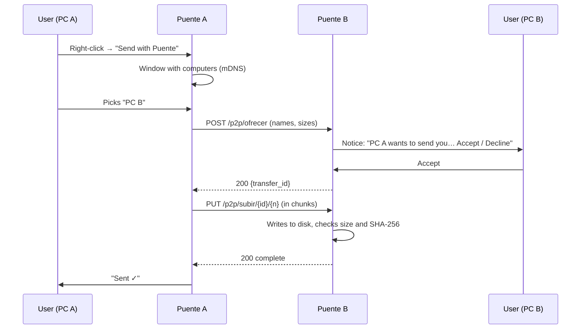

# 📡 Proposal: send files between PCs, AirDrop style

> **Status:** implemented. This is the original specification, kept for reference. It uses the project’s former name (Puente) and the routes, fields and functions as they were named back then; the code and the [README](../README.md) describe how it works today.

## 1. Goal

Puente already runs in the background on every computer. It should also send files **from one PC to another**, like AirDrop:

1. **Right-click** one or more files → **“Send with Puente”**.
2. A small window lists the **nearby computers** running Puente (*Home-Fedora*, *Windows-Laptop*…). You pick one.
3. The receiving computer shows a notice: **“Windows-Laptop wants to send you foto.jpg (3 MB) — Accept / Decline”**.
4. If accepted, the file lands in `Downloads/From Puente`, and both sides show the progress.

No web pages, no external servers and no internet: everything goes over the local network.

### What does NOT change

- **The iPhone shortcuts stay the same:** *Send PC* (`POST /enviar`) and *Bring PC* (`GET /traer`) keep their exact contract (routes, `X-Clave` header, `archivo` form field, text responses). None of that can break.
- The shared clipboard, the tray icon, automatic startup and the `<name>.local` announcement keep working the same.

### Out of scope

- **Automatic PC → iPhone:** iOS doesn’t let a third-party app receive files in the background. The iPhone keeps using *Bring PC*.
- Transfers between different networks or over the internet.
- Android (can be considered later).

---

## 2. The code today

Repository: this one. Python 3.10+, a single network dependency (`zeroconf`).

| File | What it does today |
|---|---|
| `bridge.py` | `ThreadingHTTPServer` on port 8765 (`config.json → puerto`). Routes: `GET /ping`, `GET /traer`, `POST /enviar`. Authentication with the `X-Clave` header (`hmac.compare_digest`). Announces `<name>.local` with `zeroconf` (`anunciar_en_red`), checking every 10 s whether the IP changed. Global `ESTADO` state for the icon |
| `windows_system.py` / `linux_system.py` | The same interface per system: `poner_texto`, `leer_texto`, `leer_archivos`, `poner_imagen`, `leer_imagen`, `poner_archivos`, `avisar`, `abrir`, `instalar`, `desinstalar`, `DESCARGAS`. `bridge.py` picks the module from `sys.platform` (`import ... as so`) |
| `tray.py` | Icon with `pystray`: green (active) or yellow (no network); menu with IP, folder, log and quit. Runs on the main thread; the HTTP server runs on another |
| `helper.ps1` | Images, file lists and notifications on Windows through .NET/WinRT |
| `config.json` (not versioned) | `{"puerto", "clave", "nombre", "avisos", "icono"}` |

Current limitations this proposal has to solve:

- `POST /enviar` reads **the whole body into memory** (`MAX_BYTES = 500 MB`) and processes it with the `email` parser. PC↔PC has to **write to disk in chunks** and allow larger files (proposed: up to 10 GB).
- The mDNS announcement uses the generic `_http._tcp` type. Finding other Puente instances calls for a type of its own.

---

## 3. Proposed design

### 3.1 Discovery

- Besides the current announcement (left untouched), announce a service of its own, **`_puente._tcp.local.`**, named after `config.nombre`, with the port and, in the TXT record: `v=1` (protocol version), `so=windows|linux` and `id=<the computer's stable uuid>`.
- A `zeroconf` `ServiceBrowser` keeps the list of visible computers in memory (added and removed live). A computer excludes itself by `id`.
- The tray icon shows how many computers it sees (`Nearby computers: 2`).

### 3.2 Pairing (security)

Today all of a person’s computers can share the same `clave`. For PC↔PC:

- **Same owner:** if both computers have the same `clave` in `config.json`, they count as paired and it’s used as today (`X-Clave`).
- **Someone else’s computer** (optional, phase 4): pairing with a 6-digit code shown on both computers, which the user confirms (as with Bluetooth). One key per computer is saved in `config.json → equipos`.
- **Always** ask Accept/Decline on the receiving side, unless the user ticks “Always accept from this computer” (saved by `id`).
- Validate file names (`ruta_libre` already exists), reject paths, limit the total size, and let an unanswered offer expire after 60 s.

### 3.3 New HTTP protocol

Everything under `/p2p/`, with `X-Clave`, on the same server and port.

| Method and route | Body | Response |
|---|---|---|
| `POST /p2p/ofrecer` | JSON `{de: {nombre, id}, archivos: [{nombre, tamano, sha256}]}` | Waits for the user’s decision (60 s at most). `200 {id}` if accepted, `403` if declined, `408` if unanswered |
| `PUT /p2p/subir/{id}/{indice}` | The file’s bytes (streaming, `Content-Length`) | `200` when finished. Written to `<file>.parcial` and renamed after checking size and hash |
| `POST /p2p/cancelar/{id}` | — | `200` |

- Read the body in blocks (for example 1 MB) straight to the file; never all of it in memory.
- The sender shows progress (bytes sent / total).

### 3.4 Operating system integration

| Piece | Windows | Fedora (GNOME / KDE) |
|---|---|---|
| **“Send with Puente” right-click** | Entry in `HKCU\Software\Classes\*\shell\…` (no administrator needed) or a shortcut in the *Send to* folder (`shell:sendto`) | Script in `~/.local/share/nautilus/scripts/` (Nautilus) and a *service menu* in `~/.local/share/kio/servicemenus/` (Dolphin) |
| **How the order reaches Puente** | The right-click runs `pythonw bridge.py --enviar <paths…>`, which talks to the running Puente over `127.0.0.1` and closes | The same |
| **Window to pick a computer** | `tkinter` (ships with Python) in a **separate process**, because `pystray` takes the main thread | The same |
| **Accept / Decline notice** | Separate process with always-on-top `tkinter` (`-topmost`); optional: WinRT toast with buttons | Separate process with `tkinter`; optional: `notify-send --action` (GNOME supports it) |
| **Installation** | `--instalar` also adds the right-click; `--desinstalar` removes it | The same |

### 3.5 Changes per file

| File | Change |
|---|---|
| `bridge.py` | `/p2p/*` routes; `_puente._tcp` announcement; `ServiceBrowser`; `--enviar` subcommand; streaming reception |
| `p2p.py` (new) | Logic for offers, transfers, hashes and computer state, independent of the OS |
| `dialogs.py` (new) | `tkinter` windows: pick a computer, accept/decline, progress. They run as subprocesses |
| `windows_system.py` / `linux_system.py` | `instalar_menu_contextual()`, `quitar_menu_contextual()` |
| `tray.py` | Show nearby computers and transfers in progress |
| `README.md` | “Send between PCs” section in the README’s current style |

---

## 4. Acceptance criteria

- [ ] Windows ↔ Fedora on the same network: they see each other within 5 s of starting.
- [ ] Right-click → pick a computer → accept → the file arrives intact (same SHA-256).
- [ ] Declining or not answering within 60 s leaves no partial files.
- [ ] A 5 GB file transfers without going over ~100 MB of RAM on either side.
- [ ] Several files at once all arrive; repeated names get renamed (`(1)`, `(2)`).
- [ ] Without the right key, every `/p2p/*` route answers `403`.
- [ ] **Send PC and Bring PC keep working exactly the same** (test with the iPhone).
- [ ] `--instalar` and `--desinstalar` add and remove the right-click without asking for administrator rights.
- [ ] Automated tests for `p2p.py` (offers, expiry, hash, dangerous names) that run on Windows and Linux with no real network.

## 5. Suggested plan

1. **Phase 1:** `_puente._tcp` discovery + list of computers in the icon.
2. **Phase 2:** `/p2p/ofrecer` + `/p2p/subir` with streaming and the Accept/Decline notice (try it first with an `--enviar` command, without the right-click).
3. **Phase 3:** right-click on Windows and Fedora + window to pick a computer.
4. **Phase 4 (optional):** code pairing for other people’s computers.
